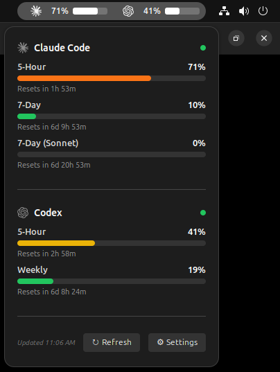

# Agents Usage Indicator

A GNOME Shell extension that shows usage quotas for AI coding agents directly in the top panel.

Currently supported providers:

- Claude Code
- Codex

The extension reads your local auth files, polls each provider's usage endpoint, and shows current utilization in the panel and dropdown menu.



## Features

- Shows agent quota usage in the GNOME top bar
- Supports multiple providers at once
- Dropdown view with per-window usage details and reset times
- Configurable refresh interval
- Configurable panel display mode: text, progress bar, or both
- Optional panel icon
- Custom credential file paths for each provider

## Requirements

- GNOME Shell 45, 46, 47, or 48
- `glib-compile-schemas`
- A valid local login for at least one supported provider

Default credential file locations:

- Claude Code: `~/.claude/.credentials.json`
- Codex: `~/.codex/auth.json`

## Install

```bash
./install.sh
gnome-extensions enable agents-usage-indicator@github.io
```

The install script:

- compiles the extension schema
- copies the extension into `~/.local/share/gnome-shell/extensions/agents-usage-indicator@github.io`

After enabling the extension, restart GNOME Shell if needed:

- X11: `Alt+F2`, then `r`, then Enter
- Wayland: log out and log back in

## Configuration

Open the extension preferences from GNOME Extensions or from the indicator menu.

Available settings:

- enable or disable individual providers
- set the refresh interval
- override provider credential file paths
- choose panel display mode
- show or hide the panel icon

## Development

Useful commands while working on the extension:

```bash
glib-compile-schemas schemas/
./install.sh
```

Main files:

- `extension.js`: GNOME Shell extension entry point
- `indicator.js`: panel button, refresh cycle, and menu UI
- `providers/`: provider-specific usage fetchers
- `prefs.js`: preferences window
- `schemas/`: GSettings schema

## Author

Didier Marin <mail@didiermarin.com>

## License

This project is licensed under the MIT License. See the `LICENSE` file for details.

## Notes

- If no configured auth file is found, that provider stays inactive.
- Usage data is fetched from the providers' remote APIs using the tokens stored in your local auth files.
